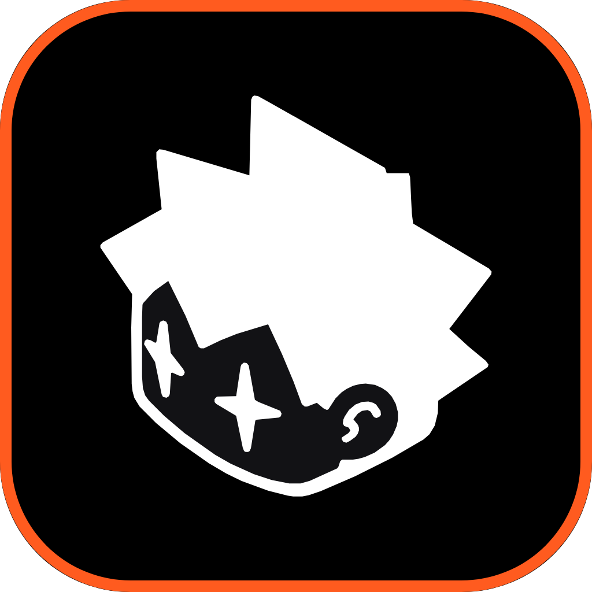
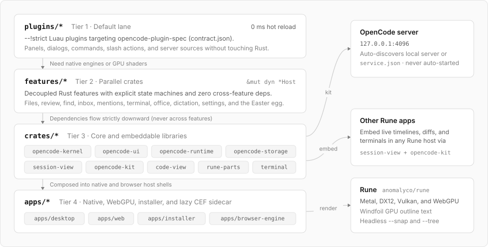

<p align="center">
  
</p>

<h1 align="center">Brocode Desktop</h1>

<p align="center">
  OpenCode Desktop, rewritten from scratch in Rust on <a href="https://github.com/anomalyco/rune">Rune</a>,
  branded for <a href="https://github.com/meeyao/brocode-cli">brocode-cli</a> and API Brother.<br>
  Native on macOS, Windows and Linux — and the same app in the browser over WebGPU.
</p>

<p align="center">
  
  
  
</p>

## This fork

A branded fork of [`anomalyco/opencode-rune`](https://github.com/anomalyco/opencode-rune) (MIT).
The engine, protocol and OpenCode-compatible features are unchanged. On top of upstream:

- App name and window title: **Brocode**
- Icon and About identity: API Brother (`apibrother.com`)
- App IDs, data folders and deep links: `com.apibrother.brocode`, `brocode://`
- No Anomaly release feed: source builds do not auto-update
- Server: a brocode / OpenCode-compatible server on `127.0.0.1:4096` (`brocode serve`), or
  `~/.config/opencode/service.json` / `~/.local/state/opencode/service.json`; `--server <url>`
  and `OPENCODE_SERVER_URL` override it. If no server answers, the client starts `brocode serve --service`
  itself (the `brocode` CLI must be installed) and prompts for the API Brother key when the server has none.

Upstream stays the source of engine fixes; rebase this fork on its `dev` branch.

## Downloads

The build workflow publishes unsigned desktop builds to `dl.apibrother.com`:

| Platform | Download |
| --- | --- |
| **Windows x64** | [brocode-desktop-win-x64.exe](https://dl.apibrother.com/brocode-desktop-win-x64.exe) |
| **macOS arm64** | [brocode-desktop-darwin-arm64.zip](https://dl.apibrother.com/brocode-desktop-darwin-arm64.zip) |
| **macOS x64** | [brocode-desktop-darwin-x64.zip](https://dl.apibrother.com/brocode-desktop-darwin-x64.zip) |

Version, sizes and SHA-256: [brocode-desktop-latest.json](https://dl.apibrother.com/brocode-desktop-latest.json).
The zips are ad-hoc signed, not notarized: right-click → Open, or `xattr -dr com.apple.quarantine Brocode.app`.

## Run from source

Rust 1.99.1 is pinned by `rust-toolchain.toml`. Start a server first:

```sh
brocode serve --service      # or: opencode serve --service
```

Then build and launch with the fast profile (no debug info, skips Office previews and the storybook):

```sh
scripts/dev-fast.sh                       # --live --plugin-hot
# or
cargo run --profile dev-fast -p brocode-desktop --no-default-features --features knobs -- --live
```

The windowed binary is `target/dev-fast/brocode-desktop`. It renders any scene offscreen for
inspection (`--snap out.png`, `--tree out.json`, `--script …`).

## Upstream

MIT, © Anomaly. `LICENSE` and `THIRD_PARTY_NOTICES.md` are kept from upstream; this fork only
changes branding and packaging. Upstream project: https://github.com/anomalyco/opencode-rune.

## What's inside

<p align="center">
  
  
</p>
<p align="center">
  
  
</p>

- **Windfoil GPU text.** Draws each glyph's exact coverage directly from its vector outline on the GPU, so text stays sharp while zooming or moving.
- **Zero Chromium at startup.** The built-in browser pane (`⌃⌘B` / `Ctrl+Alt+B`) fetches an isolated CEF sidecar (`apps/browser-engine`) lazily on demand. If you never open it, you never pay for it.
- **Real native engines.** **Ghostty-VT** (`libghostty-vt`) terminal tabs, virtualized syntax-highlighted code and split diffs (`opencode-code-view`), native GPU ```` ```ui ```` generative UI and vector diagrams (`rune-parts`), Word/Excel/PowerPoint previews via Vello (`office-preview`), local **Hex** voice dictation (`hex-client`), crash-safe SQLite with an mmap draft journal (`opencode-storage`), and 63 locales with RTL.
- **0 ms UI iteration.** Built-in `--!strict` Luau plugins (`plugins/*`) reload live in place with `--plugin-hot` without touching `rustc`.
- **Headless eyes, zero tests.** By policy, this repo has no automated tests or mocks (*"Application code is truth"*, see [AGENTS.md](AGENTS.md)). The binary renders any scene or 111-story playground view offscreen to PNG (`--snap`), dumps its live element tree (`--tree`), and replays scripted input (`--script`).
- **Weird things built right in.** Pull on the final `e` of the wordmark on a new-session tab — something lives inside it, and pulling it out pops the letters into an 800-pin 3D GPU board and Brick Breaker with synthesized sound (`features/egg`). Press `⌘⇧⌥R` (`Dev › Rewind`) to freeze the last minute of layout frames and scrub a glitch frame by frame.

## Downloads

The build workflow publishes unsigned desktop builds to `dl.apibrother.com`:

| Platform | Download |
| --- | --- |
| **Windows x64** | [brocode-desktop-win-x64.exe](https://dl.apibrother.com/brocode-desktop-win-x64.exe) |
| **macOS arm64** | [brocode-desktop-darwin-arm64.zip](https://dl.apibrother.com/brocode-desktop-darwin-arm64.zip) |
| **macOS x64** | [brocode-desktop-darwin-x64.zip](https://dl.apibrother.com/brocode-desktop-darwin-x64.zip) |

Version, sizes and SHA-256: [brocode-desktop-latest.json](https://dl.apibrother.com/brocode-desktop-latest.json).
The zips are ad-hoc signed, not notarized: right-click → Open, or `xattr -dr com.apple.quarantine Brocode.app`.

## Run from source

Start an OpenCode server locally (`opencode serve --service` or **OpenCode Desktop**), then run:

```sh
cargo run -p opencode-desktop -- --live
```

For fast local iteration (skips debuginfo, Office fonts, and standalone story modules, and enables Luau `--plugin-hot` live reload):

```sh
scripts/dev-fast.sh          # macOS / Linux
pwsh scripts/dev-fast.ps1    # Windows
```

To scaffold a new Luau plugin (`plugins/<id>/`) or decoupled Rust feature crate (`features/<id>/`), run `scripts/new-feature.sh` (or `pwsh scripts/new-feature.ps1`). See [docs/fast-builds.md](docs/fast-builds.md) for profiles, `sccache`, and fast linkers, and [`crates/opencode-plugin-spec/docs/writing-a-plugin.md`](crates/opencode-plugin-spec/docs/writing-a-plugin.md) for the plugin guide.

### Other targets

| Target | Command |
| --- | --- |
| **Standalone `session-view` playground** (no server) | `cargo run -p session-view --example read_only` |
| **Local macOS `.app`** (`~/Applications/Brocode.app`) | `apps/desktop/scripts/dev.sh` (or `--release`) |
| **Browser `wasm32`/WebGPU** (`apps/web`) | `pwsh scripts/web.ps1` |

> **Release builds:** `--profile release` is what ships — fat LTO, one codegen unit, plus the PGO profiles in `apps/desktop/pgo/` via `pwsh apps/desktop/scripts/release.ps1` (Windows x64) and `apps/desktop/scripts/build-app.sh` (Apple Silicon macOS). A plain `cargo build --release` omits the PGO profile and takes 25–60 minutes and ~10 GB RAM for one `rustc`. Use `--profile release-quick` or `--profile release-thin` for fast optimized iteration ([docs/fast-builds.md](docs/fast-builds.md)).

## Architecture

Organized by **progressive disclosure** across four tiers: start at Tier 1 and step down only when a feature needs lower-level metal. Full crate inventory, dependency graph, and wiring guide live in [ARCHITECTURE.md](ARCHITECTURE.md).

<p align="center">
  <picture>
    <source srcset="docs/assets/architecture-dark.svg" media="(prefers-color-scheme: dark)">
    <source srcset="docs/assets/architecture-light.svg" media="(prefers-color-scheme: light)">
    
  </picture>
</p>

| Tier | Path | Purpose |
| --- | --- | --- |
| **Tier 1** | `plugins/*` | Built-in `--!strict` Luau plugins (panels, dialogs, commands, server sources); hot-reloads without touching Rust |
| **Tier 2** | `features/*` | Decoupled Rust feature crates (`opencode-feature-*`) with zero cross-feature deps and non-generic `&mut dyn *Host` boundaries |
| **Tier 3** | `crates/*` | Shell kernel (`opencode-kernel`), UI foundation (`opencode-ui`), headless runtime (`opencode-runtime`), platform/storage/search/i18n/plugin-runtime libraries, and embeddable crates (`session-view`, `opencode-code-view`, `opencode-kit`, `rune-parts`, `terminal`, `browser-pane`, `office-preview`, `project-icon`, `hex-client`, `otlp-lite`) |
| **Tier 4** | `apps/*` | Host shells and packaging: `apps/desktop` (`opencode-desktop` lib + native bin), `apps/web` (`opencode-web` wasm32/WebGPU), `apps/installer` (`opencode-rune-setup`), and `apps/browser-engine` (on-demand CEF sidecar, excluded from workspace) |

<details>
<summary><strong>Embedding <code>session-view</code> in another Rune app</strong></summary>

<br>

Add git dependencies from this repository pinned to a commit rev matching your `anomalyco/rune` pin:

```toml
opencode-kit = { git = "https://github.com/anomalyco/opencode-rune", rev = "<rev>" }
session-view = { git = "https://github.com/anomalyco/opencode-rune", rev = "<rev>" }
```

Hold a `session_view::ViewState` on your app state (calling `view.setup(waker, headless)` during setup), implement `session_view::TimelineHost` (using `session_view::delegate_view_state!` for the state accessors), drive `session_view::poll(s, now, tx)` each frame, and render `session_view::read_only(s, p, id, transcript)` or `session_view::timeline_area(s, p, id, transcript, pills, header)` alongside `session_view::overlays(s, p, cx)`. See [`crates/session-view/examples/read_only.rs`](crates/session-view/examples/read_only.rs) for a complete minimal host.

</details>

## Checks

This repo has no automated tests (see [AGENTS.md](AGENTS.md)). Verify changes by running the app and the cheap pre-push guardrails (architecture layers, file size, folder shape, dialog sizes, and generated tables; rules in [ARCHITECTURE.md](ARCHITECTURE.md)):

```sh
scripts/guardrails.sh          # macOS / Linux / Git Bash
pwsh scripts/guardrails.ps1    # Windows PowerShell
```

Run `scripts/clippy.sh` separately for workspace-wide `-D warnings` checks across feature sets.
