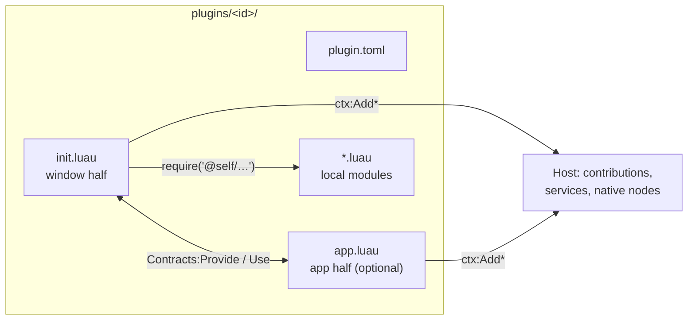
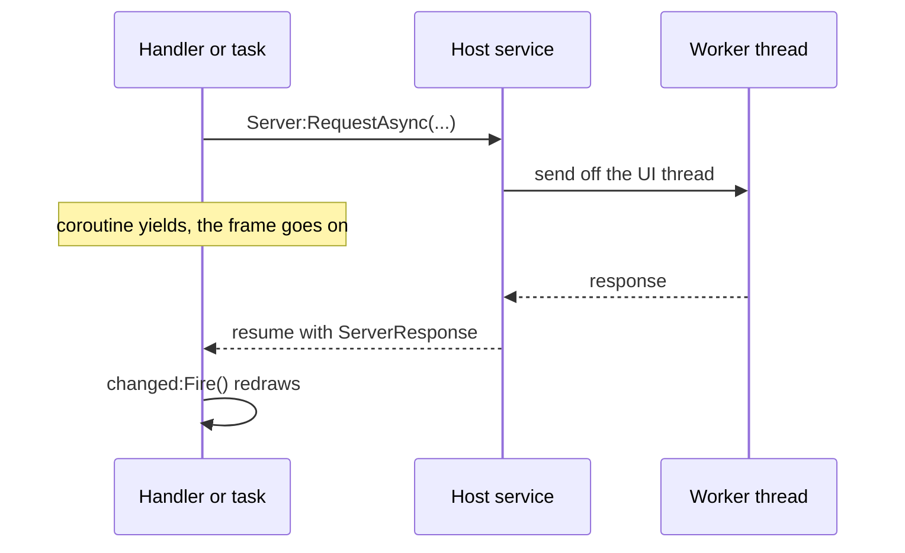

# Writing a plugin

An OpenCode plugin is a folder of `--!strict` Luau source and a `plugin.toml`. There is nothing to compile: the app loads the source, and saving a file reloads the plugin in place. The full API is in the [reference](api.md); every name below links into it.



## 1. Lay out the folder

```text
plugins/session-stats/
  plugin.toml
  init.luau
  format.luau
```

```toml
#:schema ../plugin.schema.json
id = "session-stats"
name = "Session stats"
version = "1.0.0"
contract = "1.0"
description = "A session's tokens, spend and last 20 tool calls"

[[stores]]
name = "show-spend"
```

- `contract` names the [contract version](api.md#versioning) the plugin targets. Any 1.x host runs a 1.0 plugin.
- `entry` defaults to `init.luau`, the window half. Add `app = "app.luau"` for an app half.
- The `#:schema` line gives TOML editors completion and checks from [`plugin.schema.json`](../../../plugins/plugin.schema.json).

## 2. Define a half

```luau
--!strict
local plugin = require("@opencode/plugin")
local ui = require("@opencode/ui")

return plugin.defineWindow(function(ctx)
    local Layout = ctx:GetService("Layout")

    ctx:AddCommand({
        id = "open",
        title = "Session stats: Toggle panel",
        bind = "mod+shift+s",
        slash = { name = "stats" },
        run = function()
            Layout:TogglePanel("main")
        end,
    })

    ctx:AddPanel({
        id = "main",
        title = "Session stats",
        render = function(view, props)
            return ui.text(`Session {props.sessionId}`, { color = "text-weak" })
        end,
    })
end)
```

| Half | Defined with | Runs | Use it for |
|---|---|---|---|
| Window | [`plugin.defineWindow`](api.md#requireopencodeplugin) in `init.luau` | Once per window | UI: panels, pills, dialogs, commands |
| App | [`plugin.defineApp`](api.md#requireopencodeplugin) in `app.luau` | Once per process | Processes, server sources, menu bar items, shared state |

- `ctx:GetService("Name")` returns a typed [service](api.md#services). A typo in the name is a type error.
- Each `ctx:Add*` call adds a [contribution](api.md#contributions). The host withdraws it when the half goes away.
- The halves share values through [`Contracts`](api.md#contracts): `Contracts:Provide("my-plugin", api)` in one, `Contracts:Use("my-plugin")` in the other.

## 3. Build UI with `ui.*`

```luau
render = function(view, props)
    return view:Memo("panel", `{props.sessionId}:{changed:Version()}`, function()
        return ui.col({ w = "full", pad = 16, gap = 12, fill = "bg-base" }, {
            ui.text("Context tokens", { size = 12, color = "text-weak" }),
            ui.metric({ value = total, text = format.int(total), weight = "semibold" }),
            ui.button({
                text = "Compact",
                size = "small",
                onPress = view:Handler(function()
                    Commands:Run("session.compact")
                end),
            }),
        })
    end)
end,
```

- Nodes are declarative: build the tree you want, return it, and never mutate it.
- Wrap each render in [`view:Memo`](api.md#view) with a version that changes only when the output should. An unchanged frame then runs no Luau at all.
- Colors are [semantic tokens](api.md#semantic-tokens) such as `"surface-1"` or `"status-danger"`. They follow the theme. Use `ui.hex("#RRGGBB")` only for a literal color.
- Borders on `ui.box`, `ui.row`, and `ui.col` paint over the fill without taking layout space. Use [`ui.frame`](api.md#uiframeprops) when a container's border (or `borderSides`) should take room in layout, snapped to device pixels at every display scale as a CSS `border-box` border does.
- Long lists go in [`ui.virtualList`](api.md#uivirtuallistprops), which builds only the rows on screen.
- Heavy views are [native nodes](api.md#native-nodes): `ui.terminalSurface`, `ui.browserSurface`, `ui.codeView`, `ui.diffView`, `ui.fileTree`, `ui.markdown` and `ui.genUi`. Get their handles from a service, such as `Terminal:Create` or `Workspace:OpenDocument`.

## 4. React to events and do async work

**Request a redraw when what you draw changes.** A render can read a Luau local, but the host cannot observe writes to that local. After changing a value used by a panel, label, badge, menu, or command's `enabled` or `hidden` callback, fire a signal created with `ctx:CreateSignal()` or call `:Refresh()` on the contribution. Include the signal's `:Version()` in any `view:Memo` that reads the value. Update the value *before* notifying the host. Do not request a redraw for a retry deadline, a cache fill that nobody displays, or a duplicate answer.

```luau
local changed = ctx:CreateSignal()
local title = ""
local function setTitle(nextTitle: string)
    if title == nextTitle then return end
    title = nextTitle
    changed:Fire()
end
```

Reactive service reads keep their own invalidation: for example, a render that reads `Terminal:List` can follow a host-side title change. If you *copy* the title into plugin state and draw that copy instead, notify on changes to the copy. A coroutine resuming is not a redraw request. Installed plugins, override folders, and `--plugin-dir` plugins using contract 1.0 keep their legacy implicit invalidation; they do not need to migrate to keep working. Do not rely on that fallback in new code.

```luau
local Server = ctx:GetService("Server")
local changed = ctx:CreateSignal()

Server:OnEvent("session.updated"):Connect(function(event)
    changed:Fire() -- redraws, and bumps changed:Version()
end)

local function refresh(sessionId: string)
    task.spawn(function()
        local res = Server:RequestAsync("GET", `/api/session/{sessionId}`)
        if res.ok then
            changed:Fire()
        end
    end)
end
```



- Every event source is a [`Signal`](api.md#signal): `:Connect`, `:Once` and `:Wait`. Connections end with the half.
- Methods named `…Async` yield. Call them from a handler, a signal callback or a [`task`](api.md#task) function.
- Render callbacks (`render`, `label`, `show`, `match`) must not yield. Read cached data there, such as [`Server:Resource`](api.md#server).
- `task.delay` and `task.wait` cost no CPU while they wait.

## 5. Keep state

| State | Use |
|---|---|
| Saved with the app, shared by every window | [`Store:Value`](api.md#store) and `Store:SessionValue`; declare the names under `[[stores]]` |
| Text the user types | [`ctx:CreateEditor`](api.md#windowcontext) with `ui.field`; text, caret and undo survive a reload |
| Plain Luau tables | Locals in the setup function; `ctx:BindHotState` carries them across a hot reload |

## 6. Speak the user's language

Put a catalog per language in `locales/<id>.json`, flat objects of message keys in the app's format: `{{name}}` placeholders, and plural forms as `key.one`, `key.other` (CLDR categories).

```json
{ "stats.title": "Session stats", "calls.one": "{{count}} tool call", "calls.other": "{{count}} tool calls" }
```

```luau
local I18n = ctx:GetService("I18n")
ui.text(I18n:T("stats.title"))
ui.text(I18n:T("calls", { count = #calls }))
ui.text(I18n:Number(cost, { style = "currency" }))
ui.text(I18n:Date(session.created, "dateTime"))
```

- [`I18n:T`](api.md#i18n) looks up the plugin's `locales/<lang>.json`, falls back to `locales/en.json`, then to the host's own message catalog (singular and plural keys), and finally to the key itself. With a number `count`, it picks the plural form the language uses. Built-in plugins whose copy already lives in the host catalog do not need to duplicate `locales/*.json` files.
- `Number`, `Date`, `RelativeTime`, `RelativeDay` and `List` write values as the app writes them in the interface language. For currency amounts that should follow the locale's full currency pattern (such as `1.234,50 $` or `1,84 USD`) rather than a compact `$` prefix, pass `localePattern = true` to `I18n:Number`.
- `I18n:Direction()` says whether the language reads right to left. Everything drawn redraws when the language changes; connect `I18n.Changed` for state you keep.

## 7. Check it

Run these from the repository root:

```sh
luau-lsp analyze --platform=standard --definitions=@opencode=plugins/opencode.d.luau plugins
selene plugins
stylua --check --glob "**/*.luau" --glob "!**/*.d.luau" plugins
```

- `luau-lsp` 1.70 or later checks types under both of Luau's solvers. In an editor, add `plugins/opencode.d.luau` to the `luau-lsp.types.definitionFiles` setting. `plugins/.luaurc` already turns on strict mode and maps `@opencode/*`.
- **Module `require` paths (`@self/` vs `./`):** the host follows Luau's standard require-by-string rules (the same rules `luau-lsp` uses). Because `init.luau` represents its folder as a module, `@self/format` resolves a child inside the plugin folder (`format.luau`), while `./format` from `init.luau` steps to the folder's parent and fails. Inside a sibling module such as `view.luau`, the module itself is already a child of the folder, so `./format` resolves a peer in the same folder (`format.luau`), while `@self/format` would look for `view/format.luau` and fail.
- Luau's older type solver widens string unions in two places. Annotate the local (`local mode: DiffMode = store:Get()`), and cast a union-typed store through `any`: `Store:Value("mode", "split" :: any) :: StoreValue<DiffMode>`.

The samples in [`samples/`](../samples) pass all three checks: `session-stats` (command, setting, panel, virtual list), `goal` (composer pill and popover, server events), `workbench` (every native node, MCP tool, link handler) and `wsl-lite` (app half, processes, server source, dialog).

## Worked example: a modal dialog (`plugins/usage/`)

The built-in [`plugins/usage/`](../../../plugins/usage/) plugin implements a complete pure-UI modal dialog (command palette entry, live HTTP fetch with cached refresh and timeout, explicit state machine, localized formatting, countdown ticking, and model-picker budget badges) without any Rust feature crate:

```text
plugins/usage/
  plugin.toml       # contract = "1.5", zero [[stores]]
  init.luau         # window half: command + dialog wiring, async fetch, timeout, countdown ticker, model badges
  machine.luau      # explicit state machine (loading | refreshing | ready | signed-out | failed)
  limits.luau       # wire JSON parser, model-budget calculation, and sorted view model (stable tie-breaking via index)
  view.luau         # declarative ui.* layout over semantic tokens (using ui.frame for border-box panels)
```

```luau
--!strict
local plugin = require("@opencode/plugin")
local ui = require("@opencode/ui")
local machine = require("@self/machine")
local view = require("@self/view")

return plugin.defineWindow(function(ctx)
    local I18n = ctx:GetService("I18n")
    local Composer = ctx:GetService("Composer")
    local Server = ctx:GetService("Server")
    local Dialog = ctx:GetService("Dialog")
    local System = ctx:GetService("System")

    local changed = ctx:CreateSignal()
    local openState: machine.OpenState? = nil
    local timeoutThread: thread? = nil

    local function sync(effect: machine.Effect)
        local cur = openState
        if cur == nil then return end
        if not Server:IsLive() then
            machine.step(cur, { type = "loaded", attempt = effect.attempt, info = nil })
            changed:Fire()
            return
        end
        timeoutThread = task.delay(machine.TIMEOUT_S, function()
            if openState ~= nil then
                machine.step(openState, { type = "timed-out", attempt = effect.attempt })
                changed:Fire()
            end
        end)
        task.spawn(function()
            local res = Server:RequestAsync("GET", `/api/experimental/usage/limits?location%5Bdirectory%5D={Server:EncodeUri(cur.directory)}`)
            -- Guard against stale attempts and closed dialogs before mutating openState.
            if openState == cur then
                machine.step(cur, res.ok and parseEvent(res, effect.attempt) or { type = "failed", attempt = effect.attempt })
                changed:Fire()
            end
        end)
    end

    local cmdReg: Contribution? = nil
    local dlgReg: Contribution? = nil
    local function register()
        if cmdReg then cmdReg:Withdraw() end
        if dlgReg then dlgReg:Withdraw() end
        cmdReg = ctx:AddCommand({
            id = "view",
            title = I18n:T("command.usage.view"),
            description = I18n:T("command.usage.view.description"),
            order = 560,
            enabled = function() return Composer:Active() end,
            run = function()
                local state, effect = machine.open(Composer:Directory(), Composer:Model())
                openState = state
                changed:Fire()
                Dialog:Open("main")
                sync(effect)
            end,
        })
        dlgReg = ctx:AddDialog({
            id = "main",
            title = I18n:T("usage.title"),
            size = "normal",
            layer = "standard",
            radius = 12,
            hideScrollbar = true,
            render = function(v, props)
                if openState == nil then return nil end
                local nowMs = System:Now()
                return v:Memo("usage-dialog-body", `{changed:Version()}:{openState.load.status}:{I18n:Locale().id}`, function()
                    return view.render(I18n, openState.load, nowMs, {
                        onRetry = v:Handler(function() ... end),
                    })
                end)
            end,
            onDismiss = function()
                openState = nil
                if timeoutThread then task.cancel(timeoutThread) end
            end,
        })
    end

    register()
    I18n.Changed:Connect(register)
end)
```

Key patterns from this port:
- **Overlay stack, layer, and focus restoration are host-managed.** Calling `Dialog:Open("main")` pushes the dialog onto the shell's `OverlayStack` (so pressing `Escape` over Settings or another modal pops only the top dialog and restores focus to where it was before the dialog opened). Set `layer = "standard"` on `DialogSpec` for ordinary dialogs that should sit beneath elevated system recovery and server dialogs (the default `"elevated"` stays above them). Use `ui.dialogHeader` for the standard title bar and close button.
- **Explicit state machine + attempt fencing.** Every async fetch carries a monotonically increasing `attempt` number checked in `machine.step` so slow responses or expired `task.delay` timeouts from earlier attempts cannot overwrite a retry or a closed dialog.
- **Offline/fixture detection.** Check `Server:IsLive()` before issuing HTTP requests so offline fixture windows skip network calls and immediately show their offline state.
- **Runtime language updates.** Because `CommandSpec.title`/`description` and `DialogSpec.title` are evaluated when registered, wrap registration in a helper and re-run it on `I18n.Changed` after calling `:Withdraw()` on the previous `Contribution` handles.
- **Host catalog reuse.** Because all `usage.*` and `command.usage.*` strings already live in the host's catalog (`crates/opencode-i18n`), `plugins/usage/` ships no `locales/*.json` files and lets `I18n:T` fall back directly to the host catalog.
- **Border-box panels across DPI scales.** Panels use `ui.frame` so their `0.5` pt border participates in layout and snaps to whole device pixels identically at 1x, 1.25x, 1.5x, and 2x display scales.
- **Model-picker annotations from one source of truth.** The plugin connects to `Composer.PickerChanged`, refreshes limits when `"model"` opens, and publishes inline model badges via `Models:SetBadges` over `Models:List()`, sharing one fetch, parser, and cache between the dialog and the model picker.
- **JSON `null` vs missing fields.** Luau represents JSON `null` as `nil`, so a server response of `{"data": null}` looks identical to `{}` in `res.json`; inspect `res.text` when an explicit `null` carries semantic meaning (such as signed-out vs malformed response).
- **Stable sorting.** Luau's `table.sort` is not guaranteed stable; tie-break equal keys on their original 1-based index when order matters.

## 8. Run and install it

A plugin is its folder and nothing else: `plugin.toml`, `*.luau`, `.luaurc`, `locales/*.json` and `icons/*.svg`. The app reads no other file in it, and never loads native code from it.

| Where | How it runs |
|---|---|
| `opencode-desktop --plugin-dir <folder>` | A plugin folder, or a folder of them, for this launch. It runs without asking. |
| `<data>/plugins/<id>/` | Installed for every launch. The first run asks. It can't take a built-in's id. |
| `<config>/plugins-override/<id>/` | Replaces the built-in with the same id. The first run asks. |

`<data>` and `<config>` are `%APPDATA%\brocode` on Windows and `~/Library/Application Support/brocode` on macOS; Linux follows XDG.

- **Trust.** A plugin can read and change files, run programs and reach the network through its services. Before an installed or overriding plugin first runs, the app asks *Enable plugin "<name>"?*. The answer holds for the plugin's files as they are: the app remembers their SHA-256, and a changed file asks again, also when you reload the plugin after editing it. The plugin runs once the answer is saved, so a crash can't run it under an OK the app then forgets. *Not now* asks again on the next launch. Turning the plugin off in Settings forgets the OK: turning it on asks again.
- **Reload.** Saving a file reloads the plugin in place in a development build, or in any build started with `--plugin-hot`. Settings › Extensions › Plugins also has Reload, and a switch that turns the plugin off.
- **Inspect.** `opencode-desktop --plugin-index` prints every plugin, where it runs from, its state and what it contributed.

## Change the contract

`contract.json` is the single source of truth. After you edit it, regenerate everything and check that nothing drifted:

```sh
cargo run -p opencode-plugin-spec -- --write
cargo run -p opencode-plugin-spec -- --check
```

| Output | Read by |
|---|---|
| `plugins/opencode.d.luau`, `plugins/types/*.luau`, `plugins/.luaurc` | `luau-lsp` and editors |
| `plugins/plugin.schema.json` | TOML editors |
| `plugins/opencode-selene.yml` | `selene` |
| `crates/opencode-plugin-spec/docs/api.md` | People and models |
| `crates/opencode-plugin-spec/src/generated/*.rs` | The host: tokens, enums, spec records, node props, registry, manifest |

Keep a change within the [versioning rules](api.md#versioning): a 1.x contract only adds.
